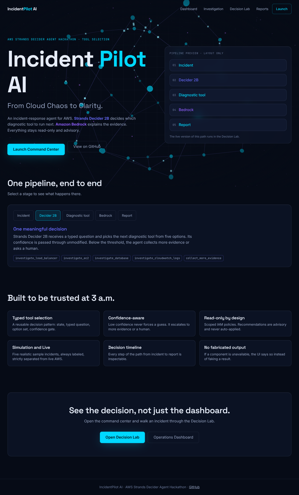

# IncidentPilot AI

> From Cloud Chaos to Clarity.

Read-only AWS incident investigation agent for the **AWS Strands Decider Agent
Hackathon** (category: Tool Selection, `#strands-decider-2b #tool-selection`).

**Pipeline:** Incident → Strands Decider 2B picks the next diagnostic tool →
read-only AWS diagnostic → Amazon Bedrock analysis → incident report → dashboard.

## Status: Phase 2 (Decider 2B tool selection) complete, pending live-model verification

| Area | State |
|---|---|
| FastAPI backend skeleton, config, schemas, API-key option, CORS | Done, tested |
| Next.js frontend: 5 routes, sidebar app shell, R3F 3D background, GSAP motion, mode badge, API client | Done, builds, screenshot-checked in headless Chromium |
| Simulation catalogue (5 scenarios, metadata only) | Done |
| Decider 2B tool selection (`backend/decision_patterns/tool_selection/`) | Implemented against the real `strands-decider` System One API; confidence-gated; reusable pattern with guide. **Not yet run against the real model** (see below) |
| Bedrock / Strands agent | **Not implemented** (Phase 3) |
| AWS diagnostics (CloudWatch, ALB, EC2, RDS) | **Not implemented** (Phase 4) |
| Live metrics, evidence panels, report export | **Not implemented** (need Phases 2-4); shown as “—” / unavailable |

Nothing in the UI is faked: unavailable components are shown as unavailable.



### Workflow Diagram


### Decider 2B: setup and verification status

```bash
pip install strands-decider        # pulls torch; downloads StrandsAgents/strands-decider-2B-hobson-v19 on first run
strands-decider serve StrandsAgents/strands-decider-2B-hobson-v19 --port 9000
# then set INCIDENTPILOT_DECIDER_URL=http://localhost:9000 in .env
cd backend && python scripts/eval_decider.py http://localhost:9000   # real-model smoke check
INCIDENTPILOT_DECIDER_URL=http://localhost:9000 pytest -m live_decider -s
```

Without `INCIDENTPILOT_DECIDER_URL` (or if the server is down) the app shows Decider as
**unavailable** and `/api/v1/decision/run` returns 503. There is no fallback decision.

**Verified:** request/response handling against the vendored real wire schema, the
confidence gate, error paths, the API, and the UI, using test doubles for the network.
**Not verified:** inference with the real model. It could not be downloaded in the
development sandbox. The `live_decider` tests and `scripts/eval_decider.py` exist to
check it and are skipped/fail-safe without a server.

## Run locally

Requirements: Python 3.11+ (tested 3.13), Node 20.9+ (tested 22).
The frontend needs **no `.env` file**: it calls the API on its own origin
(`/api/...`, `/health`).

**Option A: Docker + nginx reverse proxy (single entry point)**

```bash
cp .env.example .env          # backend settings only
docker compose up --build
# open http://localhost:8080
```

nginx routes `/` to the Next.js frontend, and `/api/*`, `/health`, `/docs`,
`/openapi.json` to the FastAPI backend. Neither app is published directly.

**Option B: two dev servers**

```bash
# backend  -> http://localhost:8000  (docs at /docs)
cd backend
python -m venv .venv && source .venv/bin/activate
pip install -r requirements-dev.txt
uvicorn app.main:app --reload

# frontend -> http://localhost:3000  (new terminal)
cd frontend
npm install
npm run dev     # Next.js rewrites /api and /health to localhost:8000
```

## Checks

```bash
cd backend  && ruff check . && pytest -q
cd frontend && npm run lint && npm run typecheck && npm test && npm run build
```

## Layout

```
backend/    FastAPI app, schemas, simulation catalogue, tests
nginx/      reverse-proxy config (used by docker compose)
frontend/   Next.js app (App Router, Tailwind v4)
shared/     openapi.json (generated)
docs/       API_CONTRACT.md, ARCHITECTURE.md
design.md   visual language       SKILL.md   design-engineering rules
```

## Security notes

- No credentials in the repo; use IAM roles / SSO. `.env` is git-ignored.
- AWS access is read-only by design. Wildcard CORS is rejected.
- Set `INCIDENTPILOT_API_KEY` to require `X-API-Key` on `/api/v1/*`.

## License

MIT
