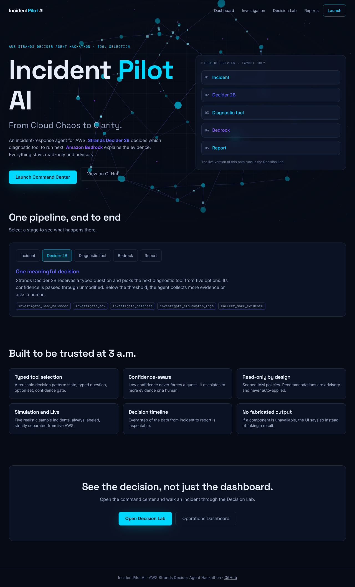

# IncidentPilot AI

> From Cloud Chaos to Clarity.

Read-only AWS incident investigation agent for the **AWS Strands Decider Agent
Hackathon** (category: Tool Selection, `#strands-decider-2b #tool-selection`).

**Pipeline:** Incident → Strands Decider 2B picks the next diagnostic tool →
read-only AWS diagnostic → Amazon Bedrock analysis → incident report → dashboard.

## Status: Phase 6 (integration, security, benchmark harness) complete, pending live Decider/Bedrock/AWS verification

| Area | State |
|---|---|
| FastAPI backend skeleton, config, schemas, API-key option, CORS | Done, tested |
| Next.js frontend: 5 routes, sidebar app shell, R3F 3D background, GSAP motion, mode badge, API client | Done, builds, screenshot-checked in headless Chromium |
| Simulation catalogue (5 scenarios, metadata only) | Done |
| Decider 2B tool selection (`backend/decision_patterns/tool_selection/`) | Implemented against the real `strands-decider` System One API; confidence-gated; reusable pattern with guide. **Not yet run against the real model** (see below) |
| Bedrock / Strands agent (`backend/app/agent/`) | Implemented: structured analysis, evidence-id grounding, report store, `/api/v1/investigations`. Tested with a Bedrock reply test double and the real offline path; **no real Bedrock call has been made** (see below) |
| Diagnostic tools (ALB, EC2, RDS, CloudWatch Logs) | Implemented: simulation backend (synthetic, labelled) and a live read-only Boto3 backend with an in-process allowlist; IAM templates in `infra/`. Tested with AWS reply test doubles; **no real AWS account has been called** |
| Reports (history, detail, JSON/Markdown export) | Done for simulation incidents |

Nothing in the UI is faked: unavailable components are shown as unavailable.



### Workflow Diagram


### Benchmark: Decider 2B vs Bedrock-only routing

`backend/scripts/benchmark.py` runs the same routing question through a real Decider 2B server
and a real Bedrock model, and records latency percentiles, token use and (if you give prices)
cost. **No results are included: none have been measured.** The script refuses to run without
real endpoints and has no simulated mode. See `benchmark/README.md`.

### Security and integration checks (Phase 6)

See `SECURITY.md` for the controls, how each is tested, and what is not covered.
`scripts/smoke.py <base-url> [--full]` checks a running stack (`docker compose up`, nginx
or Next.js dev). Verified here: it passes against the backend directly and through the Next.js
rewrites; `--full` fails with the API's reason when Decider or Bedrock is not configured.
The nginx path and `docker compose` remain untested in the development sandbox.

### UI verification (Phase 5)

Checked on the production build with Chromium: axe-core (WCAG 2.0/2.1/2.2 A and AA plus
best-practice) reports no violations on all five pages and on the Investigation page with a
report; no console errors; no horizontal scroll at 360px (a grid overflow on Investigation was
found and fixed); keyboard-only path from the skip link to running an investigation with a
visible focus ring; reduced motion shows report content immediately with no tweens; with
WebGL disabled there is no canvas and everything still works. Not done: a screen-reader pass,
other browsers, real mobile devices. The report screens in that check were rendered from test
doubles for Decider and Bedrock, so no screenshot of them is committed.

### Live mode (read-only AWS)

```bash
# .env
INCIDENTPILOT_MODE=live
INCIDENTPILOT_LIVE_TARGET_GROUP_ARN=arn:aws:elasticloadbalancing:...:targetgroup/...
INCIDENTPILOT_LIVE_DB_INSTANCE_ID=my-db          # optional
INCIDENTPILOT_LIVE_LOG_GROUP=/app/web            # optional
```

Live mode exposes one incident, `live-current`, built from CloudWatch alarms and headline
metrics for the configured targets. After Decider 2B picks a diagnostic with enough
confidence, that read-only tool runs and its findings join the evidence. Unconfigured
parts are reported "not measured"; with no target configured the API answers 503 and never
serves simulation data as live. Apply the least-privilege policy in `infra/iam/`; the app
also refuses any API call outside its allowlist. **Not verified against a real AWS account.**

### Amazon Bedrock: setup and verification status

```bash
aws bedrock list-inference-profiles --region us-east-1     # pick one enabled in your account
# .env: INCIDENTPILOT_BEDROCK_MODEL_ID=<id>  AWS_REGION=<region>  (IAM role / SSO, no keys in files)
cd backend && pytest -m live_bedrock -s                     # one real call; skipped if not configured
```

Without a model id or credentials `/api/v1/investigations` returns 503; no report is ever
fabricated. Reports are labelled AI-generated and advisory; confirmed facts are checked
against numbered evidence and demoted to hypotheses when unsupported.

**Verified:** Strands structured-output wiring against a stubbed Bedrock reply, the real
no-credentials failure path, error mapping, grounding, the API and UI.
**Not verified:** a real Bedrock call (no AWS credentials in the development sandbox).

### Decider 2B: setup and verification status

```bash
pip install strands-decider        # pulls torch; downloads StrandsAgents/strands-decider-2B-hobson-v19 on first run
strands-decider serve StrandsAgents/strands-decider-2B-hobson-v19 --port 9000
# then set INCIDENTPILOT_DECIDER_URL=http://localhost:9000 in .env
cd backend && python scripts/eval_decider.py http://localhost:9000   # real-model smoke check
INCIDENTPILOT_DECIDER_URL=http://localhost:9000 pytest -m live_decider -s
```

Without `INCIDENTPILOT_DECIDER_URL` (or if the server is down) the app shows Decider as
**unavailable** and `/api/v1/decision/run` returns 503. There is no fallback decision.

**Verified:** request/response handling against the vendored real wire schema, the
confidence gate, error paths, the API, and the UI, using test doubles for the network.
**Not verified:** inference with the real model. It could not be downloaded in the
development sandbox. The `live_decider` tests and `scripts/eval_decider.py` exist to
check it and are skipped/fail-safe without a server.

## Run locally

Requirements: Python 3.11+ (tested 3.13), Node 20.9+ (tested 22).
The frontend needs **no `.env` file**: it calls the API on its own origin
(`/api/...`, `/health`).

**Option A: Docker + nginx reverse proxy (single entry point)**

```bash
cp .env.example .env          # backend settings only
docker compose up --build
# open http://localhost:8080
```

nginx routes `/` to the Next.js frontend, and `/api/*`, `/health`, `/docs`,
`/openapi.json` to the FastAPI backend. Neither app is published directly.

**Option B: two dev servers**

```bash
# backend  -> http://localhost:8000  (docs at /docs)
cd backend
python -m venv .venv && source .venv/bin/activate
pip install -r requirements-dev.txt
uvicorn app.main:app --reload

# frontend -> http://localhost:3000  (new terminal)
cd frontend
npm install
npm run dev     # Next.js rewrites /api and /health to localhost:8000
```

## Checks

```bash
cd backend  && ruff check . && pytest -q
cd frontend && npm run lint && npm run typecheck && npm test && npm run build
```

## Layout

```
backend/    FastAPI app, schemas, simulation catalogue, tests
nginx/      reverse-proxy config (used by docker compose)
frontend/   Next.js app (App Router, Tailwind v4)
shared/     openapi.json (generated)
docs/       API_CONTRACT.md, ARCHITECTURE.md
design.md   visual language       SKILL.md   design-engineering rules
```

## Security notes

- No credentials in the repo; use IAM roles / SSO. `.env` is git-ignored.
- AWS access is read-only by design. Wildcard CORS is rejected.
- Set `INCIDENTPILOT_API_KEY` to require `X-API-Key` on `/api/v1/*`.

## License

MIT
